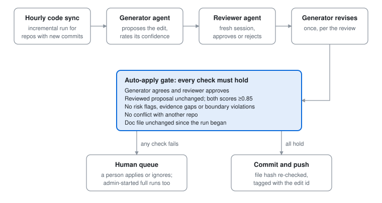

# ai-prd: agents for 100+ product and engineering staff

| Users | Agents | PRs reviewed | Runtime | Backend |
| :---: | :---: | :---: | :---: | :---: |
| 100+ staff | 5, four start on their own | 50+ | Claude Agent SDK → Codex | Python (FastAPI) · 553 passing tests |

ai-prd gave 100+ product and engineering staff at CoinEx an assistant that answered from the company's code, requirements and docs, with sources. Background agents reviewed PRs without anyone starting them, and doc edits committed only when a second agent and a code gate approved. I built it as main developer from April 2026 until the company wound down in September 2026; my lead reviewed and set direction.

## The problem

Requirements lived in ClickUp, business rules in the engineering team's design docs and the logic in code, so everyone gave AI their own partial context. Answers came back without evidence.

An earlier tool generated business docs from code, but PMs could not use the output. The real need was narrower: non-engineers asking how something works today, with sources.

## What runs on its own

Four of the five agents start without a person: a GitHub poll, hourly ClickUp and code syncs, and signed requests from other internal services start them.

| Agent | Trigger | What it does | Output | Human step |
| --- | --- | --- | --- | --- |
| PR review | GitHub poll every 5 min; open non-draft PR with a pending review request; deduplicated by PR head | Reviews the PR in its own git worktree, against the linked ClickUp requirement and a review policy | Report emailed to the PR author | Author decides what to fix |
| Requirement review | Hourly ClickUp sync; trivial edits skipped | Checks the changed spec with a requirement-check Skill | Review file with an unread badge | PM reads it; posting back to ClickUp is off by default |
| Business-doc update | After an hourly code sync brings new commits | A generator proposes edits; an independent reviewer checks them | Git commit when the gate passes | Otherwise a human queue to apply or ignore |
| Security scan | A signed request from another internal service | Inspects a file, folder or URL with restricted tools and sandbox settings; prompts mark its content as untrusted | JSON verdict (safe or unsafe) with evidence, or failed status when target URL content is unavailable | The calling service decides what to do |
| Assistant | A person's question | Answers from company knowledge, Skills and tools | Streamed answer with a citation trace | Stop, rerun; supported Codex MCP approvals |

PR review polls and emails for a reason: on the product repos we only had a read-only GitHub token. Webhooks needed admin rights on those repos, and comments needed write access. I proposed a GitHub App limited to pull-request read and write, but it wasn't approved, so the report goes by email.

## Two agents check each other

An incremental edit commits on its own only if the generator agrees, the reviewer approves, both confidence scores are at least 0.85, and every code check passes. The final proposal must match what the reviewer saw, apart from the generator’s agreement field. Any changed content or evidence, reviewer evidence gap or boundary violation goes to a human queue.

<picture>
  <source media="(prefers-color-scheme: dark)" srcset="assets/doc-gate-dark.svg">
  
</picture>

The reviewer runs in a fresh session and is instructed to check the proposal against the code evidence, looking for omissions and counterexamples. It receives the proposal and its reasons without the generator's tool-call history. The [code gate](source/backend/app/business/business_doc_updates/automation.py) enforces the approval conditions; it does not prove that the model's judgment is correct.

Business docs live in a separate git repository and follow code changes; requirements are imported from ClickUp. See the [technical notes](source/docs/architecture/task-runtimes-and-guardrails.md#document-update-boundaries) for write-back permissions and synchronization limits.

## Guardrails

Agents run in OS sandboxes with protected knowledge folders and task-specific tools. A chat-turn git guard can restore tracked edits when the repository started clean and HEAD has not moved. The Codex adapter does not provide a per-job filesystem read allowlist.

Codex supports UI approval cards for supported MCP tool requests; Claude has no equivalent approval-card bridge. Test-data writes also require an exact typed confirmation. Google sign-in, company-directory checks and admin-granted access control who can use the assistant.

PR reviews share a one-hour deadline across both model stages, with cancellation and a delivery check. URL scans must fetch nonempty, size-bounded target content before the model can return a verdict. Scan prompts mark content as untrusted, but are not an execution ban.

The [runtime and guardrail notes](source/docs/architecture/task-runtimes-and-guardrails.md) describe configuration, provider differences and enforcement boundaries.

## Decisions

I used existing agent runtimes instead of writing my own tool loop, and kept the vendor swappable.

- **Agent SDK over a hand-written loop.** Moving off plain LLM calls, I rejected a hand-built tool registry with an Anthropic tool-use loop. The Claude Agent SDK already gave file search, tool loops, Skill discovery and session resume.
- **One runtime, two vendors.** A shared session and event interface supports the Claude Agent SDK and Codex app-server, selected per task, with a global default. Production started on Claude and later moved to Codex behind the same interface, with gpt-5.6-terra as the primary production model, because Claude's headless mode couldn't run on our subscription and Codex could. I wrote a JSON-RPC client for app-server because the Codex Python SDK was not on PyPI.
- **A sandbox instead of bypassed permissions.** An earlier version ran agents with permission checks bypassed. The current adapters configure write and network restrictions for sandboxed jobs. Workspace plans organize context and writable folders, but do not establish a uniform per-job read boundary across both runtimes.
- **Full worktrees for PR review.** Each reviewed PR gets a complete git worktree, plus the ClickUp requirement linked in the PR when there is one; I removed the diff-only fallback on purpose.
- **Small jobs on a small model.** Chat titles come from a self-hosted Qwen model, not the main agent model.
- **Tests without model calls.** The current backend suite has 553 passing tests and 8 skipped; agent-flow tests use fake runtimes.

## Results during production use

100+ product and engineering staff used ai-prd, and the PR review agent reviewed 50+ PRs. Requirement reviews caught real issues, but also flagged ignorable ones when the agent lacked context. Most doc edits passed the gate and committed without a person.

Colleagues reported accurate answers and PR reviews that caught real issues. I also observed better requirement documents after adoption, and deployed workflow improvements and fixes to production based on user feedback. Developers still needed to filter review findings: some were wrong because a change spanned several repos and the agent saw only one. I added cross-repo review: the author lists the related PRs in the PR description, and the agent reviews them together.

## Linked-PR implementation

[Linked-PR review](source/docs/product/pr-code-cross-repo-review.md): enabled repositories in the same configured organization are fetched with their configured access, each base/head is pinned, and both review stages receive every context. Missing context or a version change before delivery fails the job. A single report records all reviewed SHAs. Engineering tests cover the linked-PR flow; the evaluation below measures the two-stage review workflow.

## Offline evaluation

Around May–June 2026, I evaluated the QA assistant and PR reviewer. With gpt-5.6-terra at high reasoning, I added source exploration followed by fresh-session verification, using two model sessions per review. On a 20-case PR development replay, valid findings improved from 17/26 (65%) to 20/24 (83%), and known-defect recall remained at 11/13 (85%). Unresolved findings remain in the denominator. The separate original QA evaluation passed 19/20 (95%). Codex graded against frozen references and source evidence; the results did not receive an independent human review. These are offline results, not user adoption rates.

The revised workflow used about three times the cumulative tokens and 3.46 times the median wall time. These were exposed development cases, with more compute and no contemporaneous full baseline rerun. The [sanitized evaluation appendix](evaluation/README.md) includes the sample composition, rubric, full-text baseline, per-case counts and limitations.

## Production measurement

My trade-off is to prioritize developers' time. For a background PR review, I am willing to spend more model compute and accept a longer run if it reduces the effort of checking unsupported findings. The development results and feedback informed that trade-off; we did not quantify human time saved.

The measurement gap was the rate of finding acceptance and time savings in production. On Claude, chat turns recorded cost, tokens, duration and turn count; the Codex route recorded tokens, but these never became an outcome report. If I built it again, I would track:

- Share of review findings people act on, for both PRs and specs
- Share of doc edits auto-applied vs queued, and how many queued edits people approve
- Cost per agent run, with a weekly report and a budget
- Liked vs disliked answers, which were stored but never summarized

I would give each agent one target and switch off any agent that misses it for a month.

## Where I kept workflows instead

Not every job needs an agent; these three ran as fixed workflows on purpose.

| System | Volume | How it works | Why not an agent |
| --- | --- | --- | --- |
| Support bot | 1,000+ conversations a day, 18 languages | A single routing call per message sends it to a Help Center answer or a ticket handoff, and rewrites the question for search. About 20% of conversations showed a ticket card or link. Improved answers, retrieval and handoffs from user feedback; validated fixes with bad-case replay and regression tests | A ReAct loop would add too much latency in a chat window |
| Translation service | 18 languages, 23 content types, about $50 a day | Code picks the model by content type; validators fall back to a second model or re-split text when output breaks. New models go through a 17-language LLM-judge bake-off first; Gemini 3.7 Flash took the strong tier after leading one (9.4/10, no translation below 8) | The steps never change, so a fixed pipeline is cheaper and easier to audit |
| KYC image pre-check | A few hundred submissions a day after it went live in September 2026; results looked in line with the offline test, but the company stopped a week later, before production numbers were exported | A self-hosted Qwen vision model reports facts for each ID image; code rejects only clear mismatches at 0.90 confidence or higher and never approves. On 83 test images labeled by Codex visual review, it got content type, document type and side all right on 76, about 92% | A decision about real users has to be predictable and auditable: one call, no tools, and the rule lives in code |

The next agent on my list covered support cases the bot could only answer with articles, such as a withdrawal that had not arrived. It would get read-only tools to check status, a step cap, and a ticket when unsure.
